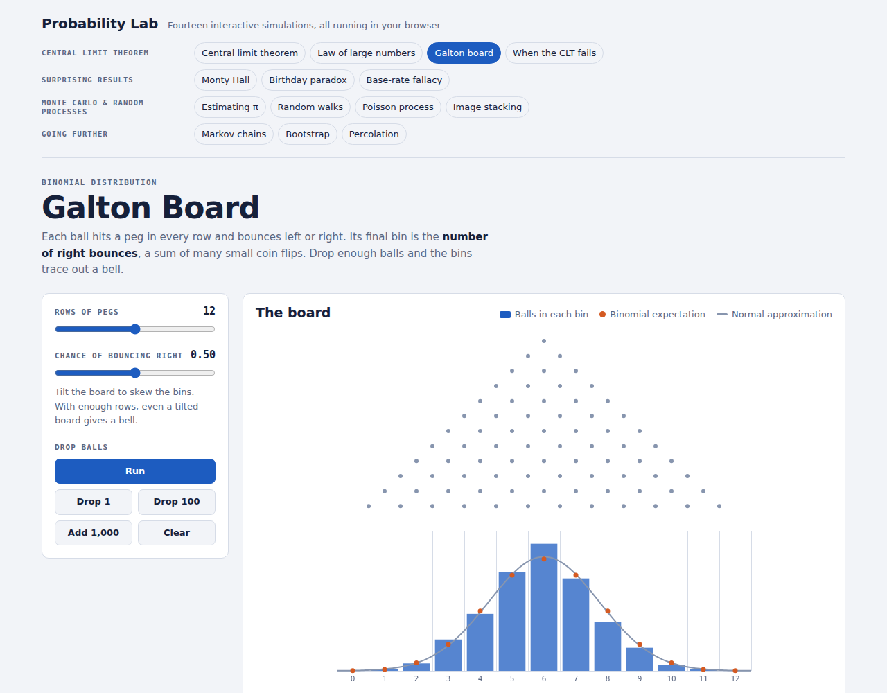

# Probability Lab

Fourteen interactive probability simulations that run entirely in the browser. Each one pairs a live simulation with the theory it should match, so you can watch randomness settle into predictable patterns and see where intuition goes wrong.

No build step, no dependencies, no server: plain HTML, CSS and JavaScript.

[Probability Lab Demo](https://jurgenkobierczynski.com/Probability_Lab/index.html)



## Made with Claude

Made using Claude Sonnet 5 High

## The simulations

### Central limit theorem

| Simulation | What it shows |
| --- | --- |
| **Central limit theorem** | Averages of samples from seven populations (uniform, exponential, die, biased coin, bimodal, log-normal, U-shaped) converge to N(μ, σ²/n). Compares measured mean, SD and skewness with μ, σ/√n and γ/√n. |
| **Law of large numbers** | Running averages of coin flips, die rolls or waiting times settle on μ inside a μ ± 2σ/√n band. Up to 25 paths at once. |
| **Galton board** | Animated balls bounce through 4–20 rows of pegs. Bins are compared with the exact binomial expectation and its normal approximation. Tilt the board with the bounce probability. |
| **When the CLT fails** | Normal and Cauchy running averages side by side. The average of n Cauchy draws is Cauchy again, so the histogram looks the same for every n. |

### Surprising results

| Simulation | What it shows |
| --- | --- |
| **Monty Hall** | Play rounds yourself with 3 or 10 doors, then simulate 10,000 games of "always stick" against "always switch". |
| **Birthday paradox** | A calendar of one random room and the exact collision curve with your simulated rooms. A hash mode shows collision probability for 8- to 256-bit hashes and tests up to 32 bits by hashing until the first repeat. |
| **Base-rate fallacy** | Bayes' theorem as natural frequencies: every positive result as a dot, real cases against false alarms. Presets for intrusion alerts, a screening test, a rare disease and a spam filter. |

### Monte Carlo and random processes

| Simulation | What it shows |
| --- | --- |
| **Estimating π** | Darts in a circle or Buffon's needle, with the estimate converging inside a ±2 SD band that shrinks like 1/√N. |
| **Random walks** | 400 walkers in 1D spreading like √t, a 2D diffusion cloud, and gambler's ruin with the exact win probability and expected game length. |
| **Poisson process** | A live arrivals timeline, counts per second against the Poisson pmf, and gaps against the exponential density. Checks that mean and variance both equal λ. |
| **Image stacking** | A synthetic star field with sky shot noise and read noise. Stacking frames shows SNR growing like √N, measured on a faint target star. |

### Going further

| Simulation | What it shows |
| --- | --- |
| **Markov chains** | A state diagram with a hopping token, time-in-state bars against the stationary distribution, and an editable transition matrix. Presets: weather, a PageRank web surfer, and a slow-mixing two-state chain. |
| **Bootstrap** | Resampling three example datasets to get bootstrap standard errors and 95% percentile intervals for the mean, median or SD, compared with the t-interval. |
| **Percolation** | A grid that opens squares as p rises, highlighting the cluster that spans top to bottom. Measures the spanning probability for 20×20, 50×50 and 100×100 grids to show the transition sharpening near p꜀ ≈ 0.5927. |

Every simulation opens with example results already on screen, has a *Run* button that animates it, and ends with a short explanation and things to try.

## Getting started

Open `index.html` in any modern browser. It works straight from disk.

To serve it locally instead:

```bash
python3 -m http.server 8000
# then open http://localhost:8000
```

Each simulation has its own address, so you can link to one directly: `index.html#monty`, `#birthday`, `#stacking` and so on.

### GitHub Pages

Everything is static, so GitHub Pages works as is: **Settings → Pages → Deploy from a branch**, then pick the branch and folder that hold `index.html`.

## Project structure

```
.
├── index.html            # page shell: header, navigation, script tags
├── css/
│   └── lab.css           # colour tokens (light + dark), layout, components
├── js/
│   ├── core.js           # shared helpers (U) and the registry/router (Lab)
│   └── sims/             # one file per simulation, in menu order
│       ├── clt.js
│       ├── lln.js
│       ├── galton.js
│       ├── cauchy.js
│       ├── montyhall.js
│       ├── birthday.js
│       ├── bayes.js
│       ├── pi.js
│       ├── randomwalk.js
│       ├── poisson.js
│       ├── stacking.js
│       ├── markov.js
│       ├── bootstrap.js
│       └── percolation.js
├── screenshot.png
└── README.md
```

## How it works

**Registry and routing.** Each file in `js/sims/` calls `Lab.register()` with an id, a group, its HTML and an `init(root)` function. `Lab.boot()` builds the grouped navigation and shows the simulation named in the URL hash. A simulation's DOM and state are built the first time you open it and kept when you switch away, and its animation pauses.

**Shared helpers (`U`).** `core.js` provides:

- random variates: Box–Muller normals, Poisson, a seeded PRNG (mulberry32), and exact binomial and Poisson pmfs via a Lanczos log-gamma
- canvas charts: `U.plot()` draws axes, grid and nice ticks (linear or log) and returns scales, plus helpers for lines, bars, reference lines and curves
- `U.animator()`, a small requestAnimationFrame loop that stops when a step returns `false`
- formatting and small DOM helpers for stats, chips and panels

**Rendering.** All charts are drawn on `<canvas>` at the device pixel ratio, with colours read from the CSS custom properties. The page follows the system light or dark setting and redraws when it changes. Long running series (the LLN, Cauchy, Monty Hall and π charts) are recorded at log-spaced indices so they stay fast at 100,000+ steps.

**A few implementation details worth knowing:**

- *CLT, discrete populations.* Sample means of a die or coin fall on a lattice with spacing 1/n. The histogram uses bins that are whole multiples of that spacing, centred on lattice points, to avoid aliasing.
- *Image stacking.* Frames are generated as sky + stars + Gaussian noise with variance equal to signal + read noise², the normal approximation to Poisson shot noise. SNR is measured with a 3-pixel aperture and a star-free background patch.
- *Markov chains.* The stationary distribution comes from power iteration. The second eigenvalue's magnitude is estimated by power iteration on zero-sum left vectors.
- *Percolation.* Clusters are found with union–find. Each grid keeps its random numbers, so squares only ever open as p rises.

## Adding a simulation

1. Create `js/sims/yourname.js`:

   ```js
   Lab.register({
     id: 'yourname', group: 'Going further', title: 'Your Title', short: 'Nav label',
     html: () => U.layout({ eyebrow: '…', title: '…', lede: '…', controls: '…', charts: '…', notes: '…' }),
     init(root) {
       // wire up controls inside root, draw with U.plot(...)
       return { render() { /* redraw */ }, stop() { /* pause animation */ } };
     }
   });
   ```

2. Add a `<script src="js/sims/yourname.js"></script>` tag to `index.html` before `Lab.boot()`.

The group must be one of the four names in `core.js` (`GROUPS`).

## Limitations

- Randomness comes from `Math.random()`, which cannot be seeded, so runs are not reproducible. The star field in the stacking demo is the exception: it uses a fixed seed.
- Some simulations cap their work to stay responsive: 100,000 sample means (CLT), 2 million throws (π), 1,000 frames (stacking), and hash collision tests up to 32 bits.
- The Poisson and image-stacking noise use normal approximations where counts are large.
- Fonts (Bricolage Grotesque, Public Sans, JetBrains Mono) load from Google Fonts. Offline, the page falls back to system fonts and works the same.

## Browser support

Current Chrome, Edge, Firefox and Safari, on desktop and mobile. The page uses ES2017 JavaScript and canvas.
